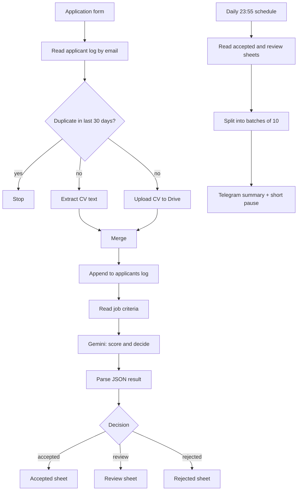

# CV Screening and Analysis Workflow

An **n8n** workflow that automates the first round of recruitment: candidates apply through a web form, their CV (PDF) is stored and read, **Google Gemini** scores it against the requirements of the chosen job, and the result is filed into Google Sheets as *accepted*, *needs review* or *rejected*. The hiring manager gets a daily summary on Telegram.

> **Status:** reference implementation / portfolio project. All credentials and identifiers in the export are placeholders (`REPLACE_ME`, `REPLACE_WITH_...`). The form, sheet headers and AI prompt are in Arabic by design; code and documentation are in English.

## Features

- **Public application form** with required fields (name, email, phone, years of experience, job, CV as PDF).
- **Duplicate protection** – the same email cannot apply for the same job twice within 30 days.
- **CV storage** – every CV is uploaded to a Google Drive folder and its link is saved with the application.
- **PDF text extraction** and **AI evaluation** with Gemini against per-job criteria kept in a Google Sheet (no code change needed to edit requirements).
- **Structured decision** – skills, education, years of experience, match score (0–100), decision and a short reasoning. Score ≥ 70 → accepted, 50–69 → review, < 50 → rejected (thresholds live in the AI node's system message).
- **Link extraction** – GitHub, LinkedIn and other links are copied only if they literally appear in the CV (the model is told not to invent any).
- **Daily Telegram digest** (23:55) of the day's accepted and to-review candidates, sent as one message per 10 candidates (and always under Telegram's 4096-character limit) with a short pause between messages, formatted so Arabic text and Latin numbers or links display correctly.
- **Human-in-the-loop by default** – any AI decision that is not exactly *accepted*, *review* or *rejected* (or a response that cannot be parsed) is routed to the *Under review* sheet instead of being rejected.
- **Failure alerts** to Telegram when a Google Sheets or Drive step fails.

## How it works

See [docs/SETUP.md](docs/SETUP.md) for the Google Sheet structure and setup steps.

## Repository layout

| Path | Purpose |
|------|---------|
| `workflow/cv-screening-workflow.json` | The n8n workflow (importable, credentials and IDs stripped) |
| `docs/SETUP.md` | Setup guide and the exact Google Sheet structure |
| `SECURITY.md` | Security model, privacy notes, responsible use of AI in hiring |
| `.github/workflows/checks.yml` | CI: secret scan and workflow export validation |

## Tech stack

n8n · Google Sheets · Google Drive · Google Gemini · Telegram Bot API

## Quick start

1. Create the Google Sheet with the five tabs described in [docs/SETUP.md](docs/SETUP.md) and a private Drive folder for CVs.
2. In n8n create credentials for Google Sheets, Google Drive, Google Gemini and Telegram.
3. Import `workflow/cv-screening-workflow.json` and attach the credentials.
4. Replace `REPLACE_WITH_GOOGLE_SHEET_ID`, `REPLACE_WITH_DRIVE_FOLDER_ID` and `REPLACE_WITH_TELEGRAM_CHAT_ID` in the nodes.
5. Fill the *Open positions* tab with your jobs and criteria, then activate the workflow.

## Responsible use

This workflow **assists** recruiters; it must not be the only decision-maker. AI scores can be wrong or biased, and a CV can contain text that tries to manipulate the model. Always have a person review rejected and borderline candidates, and tell applicants how their data is processed. Details are in [SECURITY.md](SECURITY.md).

## License

Released under the [MIT License](LICENSE).
